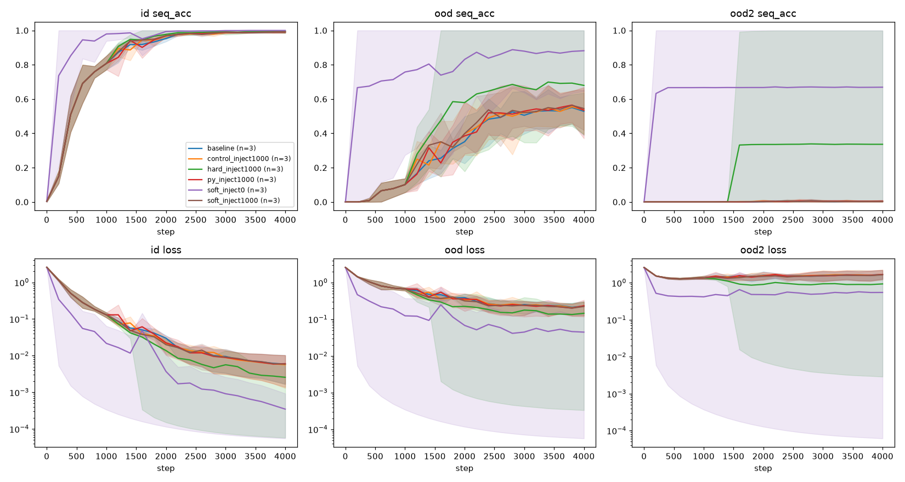
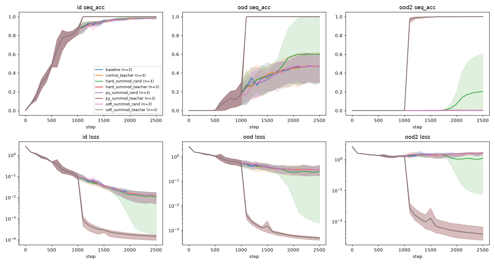

# Results log

## M1 — gated code module on running sum mod 5 (2026-11-14)
Task: `BOS x1..xn`, predict `(x1+..+xi) mod 5` at each position. Tiny NoPE GPT (2 layers, d=64, ~100k params).
Train lengths 2–16; eval id 2–16, ood 17–32, ood2 33–64. 3 seeds each. Seq accuracy at end.

### M1a: random interfaces, gate init 0 (`scripts/milestone1.sh`, 4000 steps)
| variant | id | ood | ood2 | gate |
|---|---|---|---|---|
| baseline | 0.991 | 0.529 | 0.003 | – |
| soft module injected @1000 | 0.991 | 0.545 | 0.004 | 0.00 |
| soft module from step 0 | 1.000 | 0.882 | 0.669 | 0.43 |
| hard (STE) @1000 | 0.995 | 0.680 | 0.336 | 0.26 |
| python (STE) @1000 | 0.991 | 0.535 | 0.005 | 0.00 |
| control (same params, GELU) @1000 | 0.991 | 0.536 | 0.004 | 0.04 |

Bimodal per seed: the module is either adopted (→ 1.0 everywhere) or ignored.
**Zero-gate saddle**: with g=0 and random W_in/W_out, dL/dg = <dL/dh, W_out P(W_in h)> is noise and
W_in/W_out receive no gradient. Early in training loss noise kicks g off zero; at step 1000 it doesn't.

### M1b: teacher-designed interfaces, injected @1000 (`scripts/milestone1b.sh`, 2500 steps)
Teacher init = W_in from a ridge probe of the program's input (x at items, 0 at BOS) at site 0;
W_out columns = unembedding directions of the answer tokens (×20). Gate still starts at 0.

| variant | id | ood | ood2 | steps after inject to ood2>0.95 | ablated ood2 |
|---|---|---|---|---|---|
| baseline | 0.984 | 0.471 | 0.003 | never | – |
| control + teacher interface | 0.985 | 0.471 | 0.004 | never | 0.004 |
| soft, random | 0.984 | 0.472 | 0.003 | never | 0.003 |
| hard, random | 0.987 | 0.600 | 0.203 | never | 0.002 |
| python, random | 0.984 | 0.470 | 0.003 | never | 0.003 |
| **soft, teacher** | 1.000 | 1.000 | 1.000 | 100 / 200 / 100 | 0.000 |
| **hard, teacher** | 1.000 | 1.000 | 1.000 | 100 / 200 / 100 | 0.000 |
| **python (arbitrary numpy), teacher** | 1.000 | 1.000 | 1.000 | 100 / 200 / 100 | 0.000 |

Takeaways:
- Late insertion works reliably **iff the teacher designs the interface**; then even non-differentiable
  Python code is adopted within ~100–200 steps, generalizes to 4× training length, and the model fully
  depends on it (ablation → 0).
- The control (same interface init, no algorithm) does nothing: gains come from the code, not the params.
- Differentiability of the program doesn't matter once the interface is set; the interface is the bottleneck.

## M2 — does moving skill A into code free capacity for skill B? (disjoint B)
Multitask NoPE GPT, d=32, 2 layers (26.5k neural params). Task token prefixes each sequence.
A = {summod, max} for 2000 steps; module (routed gate, teacher interface, truth contract) injected at 800.
B = {induct, count_eq, lag2} for 3000 steps with 30% A replay. Pressure arms from step 800:
`window` = group lasso (l1 3e-3) on MLP neurons + heads until end of A; `recycle` = reinit all units with
group norm < 0.05 at start of B; `sparsity` = group lasso for the whole run. 3 seeds (`scripts/milestone2.sh`).

| arm | A id | A ood | B id (per seed) | B auc | core params end |
|---|---|---|---|---|---|
| no module | 0.917 | 0.536 | 0.526 (0.54/0.51/0.53) | 0.394 | 26.5k |
| no module + window+recycle | 0.916 | 0.540 | 0.539 | 0.413 | 26.5k |
| control module | 0.921 | 0.541 | 0.536 | 0.401 | 26.5k |
| **py module** | 0.999 | 0.994 | **0.711** (0.67/0.74/0.73) | **0.514** | 26.5k |
| soft module | 0.999 | 0.992 | 0.711 | 0.514 | 26.5k |
| py + window (prune, no recycle) | 1.000 | 0.984 | 0.521 | 0.413 | 17.6k |
| py + window+recycle | 0.999 | 0.954 | 0.721 | 0.513 | 26.5k |
| py + continuous sparsity | 0.999 | 0.928 | 0.459 | 0.358 | 9.9k |

(Calibration, 1 seed: no module at d=48 / 58k params got B id 0.62.)

Takeaways:
- Externalizing sum-mod raises B learning by ~18 points with non-overlapping seeds; the control rules
  out "just more params". It beat a 2.2× wider network (1 seed).
- With the module, A needs almost no MLP: during the prune window 118–128/128 neurons died in both layers
  while A stayed ~perfect (attention + code carry A).
- Explicit prune→recycle gave no gain over plain continued training — gradient descent already reallocates.
  Pruning without recycling hurts (dead units stay dead). Continuous sparsity gives a 63% smaller core
  that holds A but can't learn B: there's a real core-size vs. new-learning trade-off.

## M2 — compositional B: reuse the sum-mod code on a feature the network must build
B = {summod_even: Σ x_j·[x_j even] mod 5, summod_pair: Σ x_j·x_{j-1} mod 5}. At the start of B the teacher
inserts a second instance of the *same* sum-mod code reading site 1 (after block 0), with a new contract
whose labels are the per-item summand ("x if even else 0", "x·x_{i-1} mod 5"). 3 seeds.

| arm | even id/ood | pair id/ood | even ood w/ modules ablated |
|---|---|---|---|
| no module | 0.90 / 0.16 | 0.18 / 0.00 | – |
| py A-module only | 0.96 / 0.28 | 0.21 / 0.00 | 0.28 |
| + py2 @site1, frozen probe interface (no contract) | 0.97 / 0.30 | 0.20 / 0.00 | 0.30 |
| + control2 @site1 + contract (supervision, no algorithm) | 0.94 / 0.21 | 0.20 / 0.00 | 0.11 |
| **+ py2 @site1 + teacher contract** | **1.00 / 0.99** | 0.21 / 0.00 | 0.00 |
| **+ soft2 @site1, no contract (gradient through code)** | **1.00 / 0.99** | 0.22 / 0.00 | 0.00 |

Takeaways:
- A new contract teaches the network to *build* the input the existing code needs ("x if even else 0")
  and route it into non-differentiable code: 0.28 → 0.99 ood, full dependence. The contract-only control
  shows this is not just auxiliary supervision.
- For this simple feature, gradient through soft code discovers the same thing without a contract.
- summod_pair fails in every arm. Contract agreement plateaus at ~0.88 (the even part only): the
  d=32 NoPE block 0 can't produce x_i·x_{i-1} at site 1. The bottleneck is building the input
  representation, not the computation — the case where the teacher would need another code primitive
  (e.g. a `prev_token` module feeding a `mul_mod` module), i.e. module composition.

## M3 — register file + curriculum ladder, code-first continual learning
Hybrid model (`hybrid.py`): growable core + register file of per-position int slots shared by code
(`oplib.py` generic ops: xval, task, shift, add/mul/cumsum mod, cummax, eq, mask, map-table,
count_prefix_eq, prev_occ_next, isitem), readers (zero-init lookup table + router; no zero-gate saddle)
and contract-trained decoders. Ladder (`scripts/ladder_m3.sh`): 9 tasks added one per stage, 50% replay of
all earlier tasks; a stage ends when the new task is ≥0.99 id / ≥0.95 ood **and** no earlier task dropped
>1 pt (id or ood).

Core: 1 block with **0 heads, 0 MLP**, d=16 → 752 params (embeddings + unembedding).
Without code this core gets summod to 14% and, given max next, forgets summod (−43 pts) while learning nothing.

| stage | task | plan (ops → reader) | steps | core | interface params | ops | table entries | worst regression |
|---|---|---|---|---|---|---|---|---|
| 0 | summod | xval, cumsum_mod | 200 | 752 | 129 | 2 | 0 | – |
| 1 | max | task(+reader@0 for routing), cummax | 200 | 752 | 627 | 4 | 0 | 0 |
| 2 | lag1 | shift | 100 | 752 | 756 | 5 | 0 | 0 |
| 3 | summod_pair | mul_mod(x, shift x), cumsum_mod | 200 | 752 | 885 | 7 | 0 | 0 |
| 4 | summod_even | map[0,0,2,0,4], cumsum_mod | 200 | 752 | 1014 | 9 | 5 | 0 |
| 5 | depth | isitem, map[1,4,0,0,0], mask, cumsum_mod | 200 | 752 | 1143 | 13 | 10 | 0 |
| 6 | count_eq | count_prefix_eq(tok) | 200 | 752 | 1272 | 14 | 10 | 0 |
| 7 | lag2 | shift k=2 | 200 | 752 | 1401 | 15 | 10 | 0 |
| 8 | induct | prev_occ_next(tok, x) | 200 | 752 | 1530 | 16 | 10 | 0 |

All 9 tasks end at 1.00 id and 1.00 ood (2× train length), zero regression at every stage, core never grew.
summod_pair (failed in M2) is solved by code→code composition through slots.

Caveat: every ladder task is exactly expressible by composing generic ops, so the network only routes and
the teacher does the algorithmic work; growth was never needed. Testing grow-vs-code needs tasks that
are *not* cheaply codeable (statistical / soft structure), with an MDL-style cost for code + tables vs weights.

## M4 — grow on demand where code can't help (hidden grammar), then partly can (planted copies)
`lm.py`: next-token LM from an empty core (1 block, 0 heads, 0 MLP, d=16). Trial-based growth: on a
plateau, try +1 head / +8 MLP per layer / +1 layer (1 head, 8 MLP) for 1000 steps each against a
no-growth control from identical state and data; grow only if a candidate beats the control by >0.005
nats, choosing best gain per added param; stop when nothing beats the control.

Data: random HMM (16 states, 2 successors each, 16 tokens, emission Dirichlet α=0.1) with secret
parameters → not codeable by the teacher. Exact Bayes-optimal loss via the forward algorithm: 1.695
(unigram 2.42).

### Pure HMM: grown vs fixed
| model | core params | loss | gap to Bayes |
|---|---|---|---|
| fixed 1 layer, 1 head | 1,136 | 2.055 | 0.360 |
| fixed 1 layer, 2 heads, 32 MLP | 2,704 | 2.047 | 0.352 |
| fixed 2 layers, 2 heads, 32 MLP | 4,864 | 1.890 | 0.195 |
| **grown** → 6 layers ≈1 head each, MLP 0–16 | 6,192 | **1.778** | **0.083** |

Growth path: +head → +layer → +layer → +head → +8mlp → +layer ×3 → stop. The policy discovers that this
task wants **depth, not width** (iterated belief updates); fixed references confirm width barely helps.

### HMM + planted copy spans (50% of sequences repeat an earlier 4–8 token span after a COPY marker)
Code = generic `suffix_next` / `suffix_len` ops (continuation + length of the longest earlier suffix
match), read at site 0. Both grown from empty.

| run | final core | loss all | copy-span tokens | grammar tokens |
|---|---|---|---|---|
| grown, no code | 4,776 | 1.871 | 2.094 | 1.858 |
| grown + suffix-match code | **4,200** | **1.821** | **1.672** | 1.829 |

Code improves copy-span loss and ends with a 12% smaller core. But copied tokens are deterministic
(ideal ≈ 0): the network doesn't fully trust the op because short spurious suffix matches are common in
HMM text and it can't tell it's inside a copy span — again an interface/routing bottleneck, not compute.

### Tiny Shakespeare (char-level, d=32, grown from empty; val = last 10% of text)
| run | final arch (heads, mlp per layer) | final core | val loss (nats/char) | wall time |
|---|---|---|---|---|
| grown, no code | (1,8) (4,56) (2,16) | 17,072 | 2.073 | 15 min |
| grown + suffix-match code | (1,8) (3,56) (2,24) | 16,568 | **1.932** | 39 min |

At matched core size the code run is ~0.14 nats/char better (≈13k core: 1.99 vs 2.14); it reaches the
no-code run's final loss (2.07) at ~11.4k core, i.e. ~33% fewer core params for the same loss. (Core
includes ~4.4k params of embeddings/unembedding at vocab 65.) Growth stopped in both when no candidate
beat the control — at this data/step scale the policy, not just capacity, limits further growth.
The pure-Python suffix op makes training ~2.6× slower; worth vectorizing.

## M4b — copy trust (`since` op) and corpus n-gram tables as code

### Copy trust on HMM + copy spans (grown from empty, single seed)
Added generic `since(tok, value=COPY)` (positions since the marker) as a third reader.

| run | core | loss all | copy-span | copy-span where code is right | where code is wrong |
|---|---|---|---|---|---|
| no code | 4,776 | 1.871 | 2.094 | 1.811 | 2.534 |
| suffix code | 4,200 | 1.821 | 1.672 | 1.029 | 2.671 |
| suffix + since | 4,448 | 1.827 | **1.496** | **0.593** | 2.898 |

Correction to M4: copy-span loss can't go to ~0 — the suffix-match op is right on only 61% of copy-span
targets (the first copied tokens are ambiguous until the match is long). Where the code *is* right,
`since` lets the network trust it much more (1.03 → 0.59), and it trusts it less where it's wrong.

### Tiny Shakespeare with a corpus n-gram table (orders 0–4, Witten-Bell, built by counting train split)
`ngram.py`; added to output logits with a learned per-position weight (init 1). Leave-one-out during
training (subtract the current occurrence from the counts) so the network doesn't learn to over-trust a
table that has memorized the training token.

Table alone (no network): val 1.686 (K=2: 2.054, K=3: 1.785, K=5: 1.713, K=6: 1.787).

| model (val nats/char) | no table | + n-gram table |
|---|---|---|
| empty core (4.4k, d=32) | – | 1.649 |
| fixed 2×2×64 (17k), 10k steps | 2.157 | 1.639 |
| fixed 4×4×128 (54.5k), 10k steps | 1.795 | 1.643 |
| grown, no code (M4) | 2.073 @ 17.1k | – |
| grown + suffix (M4) | 1.932 @ 16.6k | – |
| grown + table | – | 1.649 @ 4.4k (no growth helped) |
| grown + table + suffix | – | **1.636 @ 5.4k** (+1 head) |

- The table + a 4.4k-param core beats a 12× larger network without it (1.649 vs 1.795).
- With the table present, growth stops immediately and larger fixed cores barely help within 10k steps:
  what's left beyond 4-gram statistics is slow for tiny nets to learn. Train/val gaps match with or
  without the table (0.24 vs 0.22), so LOO works; the val split (end of the play) is simply harder.
- Suffix-match code still adds a little on top of the table (in-context copying of names etc.).
  **Not supported at 3 seeds — see hygiene below.**

### Hygiene — 3 seeds, 30k steps (3× the M4b budget), fixed cores, no growth (`scripts/hygiene_m4.sh`)
Tiny Shakespeare, d=32, n-gram table K=4 with LOO, suffix = `suffix_next`+`suffix_len` readers at site 0.
Val nats/char, mean ± sd over seeds 0–2 (`runs/m4h/`).

| core | no code | + suffix | + n-gram table | + table + suffix |
|---|---|---|---|---|
| empty (4.4k) | – | – | **1.643 ± 0.001** | – |
| 2×2×64 (17.0k) | 2.051 ± 0.021 | 1.940 ± 0.016 | 1.651 ± 0.008 | 1.645 ± 0.004 |
| 4×4×128 (54.5k) | 1.749 ± 0.012 | – | 1.659 ± 0.012 | – |

What holds and what doesn't:
- **Holds:** table + 4.4k core beats the 12× larger no-table network even at convergence-length training
  (1.643 vs 1.749, ~9 sd). The margin shrank from 0.15 (10k steps) to 0.11 because the big net kept learning.
- **Holds, stronger:** with the table, extra core capacity buys nothing in 30k steps (1.643 → 1.651 → 1.659,
  slightly *worse* with size). The leftover beyond 4-gram statistics is not reachable by these cores at this
  budget.
- **Holds:** suffix code on a fixed 17k core: 2.051 → 1.940 (−0.11, ~6 sd).
- **Doesn't hold:** suffix on top of the table (1.651 → 1.645) is within seed noise. The table subsumes
  most of what the suffix op provides at char level.

---
# M5 — going deeper: how much of a real model is procedure-able, and can an agent find it?

## Direction 1 — procedure-able share of real LMs (inference only)
Code predictor = local **infini-gram**: next-token counts after the longest context match in the
model's training corpus (suffix array over the reversed corpus, `audit/infinigram.py`, verified
against brute force). Compared per token with the model; plus a learned per-token mixture
(weights from match length, count, confidences) fit on half the eval docs, scored on the other half.
`scripts/audit.py`.

### TinyStories-1M…33M, index = the **full** 464M-token training corpus (400 held-out stories, 79k tokens)
| model | params (incl. emb) | model loss | top-1 model / code | tokens code ≥ model | held-out mixture loss gain |
|---|---|---|---|---|---|
| 1M | 3.7M | 1.94 | 0.55 / 0.61 | 44% | **20.5%** |
| 3M | 8.3M | 1.50 | 0.63 / 0.61 | 33% | 16.8% |
| 8M | 19.7M | 1.19 | 0.69 / 0.61 | 27% | 14.3% |
| 28M | 52M | 1.01 | 0.73 / 0.61 | 22% | 13.6% |
| 33M | 69M | 1.01 | 0.72 / 0.61 | 21% | 12.8% |

The externalizable share shrinks with model size but flattens near ~13% of loss. Caveat: 18.6% of
eval tokens have ≥32-token matches in the training set (code 99% right there) — TinyStories is
highly repetitive, so a good part of this share is near-duplicate memorization moved into a table.

### Pythia-70M…1B, index = a Pile **sample** (monology/pile-uncopyrighted shard 00; 300 val docs)
| index | code top-1 | mix gain 70M | 160M | 410M | 1B |
|---|---|---|---|---|---|
| 10M tok | 0.195 | 0.0% | 0.1% | 0.0% | 0.0% |
| 30M tok | 0.217 | 0.25% | 0.12% | 0.0% | 0.0% |
| 100M tok (0.03% of Pile) | 0.244 | 0.49% | 0.20% | 0.0% | 0.0% |
(model top-1: 0.44 / 0.50 / 0.54 / 0.56.) Gain grows with index coverage and shrinks with model
size; with ≤0.03% of the training data indexed, code adds nothing for ≥410M. Full-Pile coverage
isn't feasible locally, so this is only a lower bound. In-context copying alone (no corpus) is right
on 11% of TinyStories tokens.

## Direction 2 — decompile attention heads into library programs
Programs: prev, prev2, self, bos, induction (=`prev_occ_next`), dup, punct, uniform. Per head: best
program by pattern match (1 − TV), loss change when its pattern is *replaced* by the program
(value/output weights kept) vs *mean-ablated*. Custom HF attention hook (`scripts/decompile_heads.py`),
own-model hook (`scripts/decompile_own.py`).

| model | heads | match ≥0.5 | replace matched / ablate matched | replace ALL / ablate ALL | median match |
|---|---|---|---|---|---|
| Pythia-70M | 48 | 2 (prev, uniform) | +0.057 / +0.280 | +2.48 / +4.06 | 0.25 |
| Pythia-160M | 144 | 9 (self 4, prev 3, uniform 2) | +0.098 / +0.306 | +2.96 / +4.40 | 0.24 |
| own char model (4×4, NoPE, Shakespeare) | 16 | 5 (all uniform) | +0.61 / +1.67 | +2.24 / +1.81 | – |

Only 4–6% of Pythia heads closely match a fixed primitive; where they do, code recovers ~70–80% of
the head's contribution. Replacing every head with its best program recovers only ~33–39% of
attention's total contribution — real heads are mostly fuzzy/contextual, not our clean primitives
(no clean induction or BOS heads under these strict templates). Our NoPE char model uses uniform
averaging heads (its only way to sense position); replacing all its heads is worse than ablating.

## Direction 4 — messy language in, exact computation out (`wordmath.py`, `wm_train.py`)
Char-level word problems: operands as digits/words/"a dozen", varied templates, distractor numbers.
Splits: id (operands ≤20), distract (always a distractor), big (operands ≤50), plus held-out paraphrases.
Hybrid ops: `parse_num`, `hold`, `arith`, `render`, `since_char`, and a new **logit slot**
(code emits a char id → gated, learned-strength logit bias).

| model (v1 task, 4000 steps) | id | distract | big |
|---|---|---|---|
| pure 2×4×128 | 0.52 | 0.50 | 0.09 |
| pure 4×4×256 | 0.89 | 0.86 | 0.17 |
| my hand-designed hybrid (role contract on every number) | 0.68 | 0.64 | 0.37 |
| agent's discovered hybrid (wm1, 1500 steps) | **1.00** | **1.00** | **1.00** |

My interface was worse than the agent's: labelling the role of every number at every position let
mislabelled answer digits feed back into the computation.

## Direction 3 — automated discovery (headless Claude Code agents, `discover.py`, `discover_lm.py`)
Each iteration: `claude -p` reads diagnostics, writes ops/labels/plan in a workspace, self-checks;
the harness trains a trial and keeps the change only if it improves (score, then smaller core).
The agent starts *without* my task-specific ops.

### Word problems
| run | what the agent did | score | core params | secret held-out | agent cost |
|---|---|---|---|---|---|
| wm1 (v1) | iter 1: code parses mentions, computes, emits; network decides op + "distractor first?" | 0.098 → **1.00** | 57k | (repo paraphrases 0.885) | $0.66 (+$1.14 wasted no-op iters) |
| wm2 (v2 + core objective) | iter 2: **removed all transformer layers**; keyword rules for roles/op | 1.00 | **7.4k** | – | $1.30 |
| wm3 (v3: neutral question) | all-code rules; **read the held-out templates from the repo and copied cue words** (disclosed) | 1.00 | 7.6k | 0.63 (repo set: 1.0, contaminated) | $0.63 |
| wm4 | secret set leaked via inherited env var (disclosed) | 1.00 | 7.6k | 0.775 (contaminated) | $0.78 |
| **wm5 (clean)** | all-code: multiply/remove-verb lexicons, default add, only operand sentences | **1.00** | 7.6k | **0.825** | $0.72 |
| pure 4×4×256 (v3, 4000 steps) | – | 0.58 | 206k | **0.035** | – |
| pure 2×4×64 (v3) | – | 0.07 | 57k | 0.025 | – |

Findings:
- On a finite template grammar the agent externalizes **everything**, including the "soft" parsing,
  and deletes the network. It also exploits generator artifacts (op readable from the question
  wording; distractor position), which is why v3/neutral questions and a secret held-out set were needed.
- On truly unseen phrasings the agent's code generalizes far better than trained networks
  (0.825 vs 0.035): the code carries the agent's own world knowledge (which verbs mean removal),
  which a small net trained only on the generator cannot have.
- Two evaluation leaks happened (repo-readable templates; inherited env var). Both were caught because
  the agent disclosed them; the harness now strips the secret from the agent's environment.
- The keep rule needs a non-saturating objective; once score hit 1.0 most iterations were no-ops.

### Tiny Shakespeare (`discover_lm.py`; fixed 17k-param core, 4000 steps; n-gram/suffix code hidden)
| iter | agent change | val loss | cumulative agent cost |
|---|---|---|---|
| 0 | no code | 2.276 | – |
| 1 | **rediscovered a corpus n-gram table** (order 8, Witten-Bell) **with leave-one-out** | 1.523 | $0.47 |
| 2–4 | smoothing variants (KN worse), table-confidence op, cross-fold LOO | rejected (<0.005 gain) | $1.99 |
| 5 | blend weights fit on held-out training text to mimic val shift | 1.506 | $2.54 |
| 6 | mixer over several smoothings per context depth | **1.498** | $3.16 |

Loss saved vs. effort: one iteration ($0.47) captured 0.75 of the 0.78 nats gained; the next five
iterations added 0.025. The agent beat my hand-built table + net (1.64) but never tried in-context
copying. Caveat: by iter 6 the "table" contains fitted blend weights, i.e. some learned parameters now
live in code and are not counted as core.

---
# M6 — when and where to insert code (follow-up to doubleAI's "Can LLMs redesign themselves as they train?")

doubleAI insert code mid-training, after errors plateau, choosing *what* from clustered "phantom
gradients" (dL/dh) and *where* from the layer where that gradient peaks. Their timing result: an
exact-match lookup inserted at step 1,200 gives better beyond-window recall than one present from step 0
(72% vs 55%), which they attribute to shortcut learning. Two questions for us: does that replicate at our
scale, and can we choose code far earlier (greedily) without losing anything?

### 1. Lookup timing replication (`llmc/early.py`, `runs/early/`, 3 seeds, 4000 steps)
Char-level Tiny Shakespeare, T=256, attention limited to the last 16 chars. Lookup = parameter-free code:
the char after the latest earlier match of the last 4 chars, fed to every head as an extra key/value
through a zero-init gate. "Far copy" = tokens whose lookup match is ≥16 back and correct (5.2% of tokens,
unreachable by windowed attention). Val nats/char:

| core | arm | all tokens | far copy | near copy | other tokens |
|---|---|---|---|---|---|
| 1×2×32 (16.7k) | no lookup | 2.068 ± .006 | 1.770 | 1.666 | **2.086** |
| | full attention, no window | 2.237 ± .018 | 1.989 | 1.882 | 2.252 |
| | lookup inserted at step 1200 | 2.047 ± .006 | 1.140 | 1.199 | 2.100 |
| | lookup from step 0 | **2.036 ± .019** | **0.602** | **0.846** | 2.119 |
| 2×4×64 (29.2k) | no lookup | 1.913 ± .026 | 1.651 | 1.443 | **1.929** |
| | full attention, no window | 2.022 ± .014 | 1.731 | 1.554 | 2.040 |
| | lookup inserted at step 1200 | 1.878 ± .024 | 0.693 | 0.796 | 1.947 |
| | lookup from step 0 | **1.862 ± .009** | **0.531** | **0.784** | 1.939 |

- **doubleAI's late-insertion advantage did not replicate here.** Lookup from step 0 is at least as good
  overall and much better on the copy tokens it exists for (0.60 vs 1.14 for the small core).
- **The shortcut effect is real but small:** with the lookup the network does slightly worse on
  everything else (+0.01 to +0.03), more so when present from the start. It's a trade, not a loss.
- Tiny cores trained worse with full attention than with the window in 4000 steps (learned absolute
  positions over 256 slots).
- Caveats: char-level, 4000 steps, a sigmoid side channel instead of joining the softmax, ~1000× smaller
  than their models.

### 2. Choosing code early: cheap scores vs the real gain (`llmc/greedy.py validate`)
Fixed 2×2×64 core (d=32, our NoPE Hybrid). 12 candidate code features on the raw text: k-gram lookups
(k = 1, 2, 3, 4, 6, 8), match length, chars since newline/space, char class, previous 1/2/3 chars. Each
can be read at site 0 or 2 through a zero-init lookup table. At steps 50, 500, 3000 of a no-code run,
three scores per (candidate, site):
- **grad**: energy of the zero-init table's centred gradient. One backward pass scores everything.
- **fit**: held-out loss drop from training only that table for 150 steps on the frozen model.
- **trial** (ground truth): insert it, train the whole model 500 steps, compare with a no-insert control.

| step | Spearman grad~trial | Spearman fit~trial | top by trial | top by fit |
|---|---|---|---|---|
| 50 | 0.66 | 0.82 | prev char @0 | prev char @0 |
| 500 | 0.68 | 0.93 | prev char @0 | prev char @0 |
| 3000 | 0.64 | 0.93 | prev char @0 | prev char @0 |

The top six by real gain are in the same order at all three checkpoints. **What to insert, and where, is
already decidable at step 50:** there was nothing to wait for. The frozen-model fit is the reliable score;
the one-pass gradient score is a usable pre-filter but over-rates "chars since space".

### 3. Greedy vs late vs all-at-once (`llmc/greedy.py run`, `runs/greedy/`, 3 seeds, 6000 steps)
- **greedy**: from step 0, every 250 steps, gradient-score everything, fit-score the top 3, insert the
  best if it gains > 0.005 (max 6 insertions).
- **late**: the same procedure starting at step 3000, standing in for doubleAI's timing.
- **all**: all 12 candidates at site 0 from step 0.

| arm | val @1000 | @3000 | final @6000 | mean over training | interface params |
|---|---|---|---|---|---|
| no code | 2.347 | 2.287 | 2.224 ± .028 | 2.375 | 0 |
| late (from 3000) | 2.347 | 2.287 | 1.849 ± .008 | 2.215 | ~9.6k |
| **greedy (from 0)** | 1.954 | **1.848** | 1.815 ± .003 | 1.989 | ~8k |
| all at once | **1.892** | 1.828 | **1.801 ± .005** | **1.945** | 21.7k |

- **Greedy reaches late's final loss by step 3000, half the training,** and still ends better
  (1.815 vs 1.849). Both pick nearly the same features (previous 1–3 chars, chars since space, char
  class), consistent with the stable rankings above. Selection cost ~50 s per run, about 25% overhead.
- **All-at-once** is slightly better again (−0.014) but uses 2.7× the interface params of greedy, more
  than the 17k core itself. Greedy gets ~97% of the gain with ~37% of the lookup-table parameters.
- **Caveat on what was picked:** this core has no positional encoding, so previous-char features
  (position information it can't easily build) dominate. Copy features rarely won at T=64.

### 4. Gradient-peak placement on M1 (inconclusive)
On the M1 sum-mod-5 baseline, raw, target-centred and |h|-scaled phantom gradients all peak at site 0.
Injecting the same module with probe/unembed interfaces at write site 0, 1 or 2 reaches 100% from all
three (2 seeds; site 0 was slower in one). A 2-layer task can't tell placement rules apart.

**Takeaway:** at small scale, insert early. The same choices are visible after ~50 steps, early insertion
learns faster and ends better, and the shortcut cost is small. If shortcut learning is the worry, the
smallest fix is a tiny "other tokens" penalty check, not a 1000-step wait.

## M7 — informed discovery: failure clusters + fast scoring (`llmc/discover_fast.py`)
The earlier agent loop (`discover_lm`, run `shake1`) gave the agent only the score, so it was guessing.
This version gives it what doubleAI used gradients for, plus a fast check:
- **`diagnose`:** takes the hardest 20% of tokens of the current best model and clusters them by
  [target-centred phantom gradient at every site, final hidden state] (k-means, K=10). For each cluster,
  `clusters.md` lists its share, mean loss, demand per site, % seen in context, % predicted by a 4-gram,
  chars since newline, top targets and 8 examples showing context, target and the model's top 3.
- **`score`:** freezes the model, trains only the candidate's new parameters for 150 steps (~5 s),
  and reports the held-out loss change overall, per cluster and on non-hard tokens.
- **Unchanged from shake1:** same fixed core (2x2x64, d=32), same 4000-step trial, same keep rule
  (beat the best by 0.005), 6 iterations.

| iter | shake1 (blind) | fast1 (informed) | what fast1 added |
|---|---|---|---|
| 1 | 1.5232 | 1.5204 | Kneser-Ney order-6 table + in-context copy reader |
| 2 | rejected | 1.5135 | table tuning chosen on true-val table-only loss |
| 3 | rejected | 1.5050 | sharper table distribution |
| 4 | rejected | 1.4983 | mixture of table orders |
| 5 | 1.5064 | (1.4942, under the 0.005 margin) | context-bucketed mixture |
| 6 | 1.4982 | **1.4915** | bucketed mixture + k-gram-6 reader at site 1 + "context order" reader at site 2 |
| kept / cost | 3 of 6 / ~$3.2 | 5 of 6 / ~$6.6 | |

- **The informed loop improves steadily:** 5 of 6 iterations kept, against 3 of 6 for shake1. It
  matched shake1's final loss at iteration 4 and ended 0.007 lower. It found in-context copying in
  iteration 1; shake1 never tried it. Each iteration cost ~2× as much because the agent ran its own
  experiments.
- **The fast scorer misjudges lookup tables.** It trains and measures on training text, so it
  rewards tables that memorize the corpus: it rated a word-context table −0.089 (better) and the
  winning table +0.057 (worse), both opposite to real val. From iteration 2 on, the agent built its
  own dev split (last 10% of the training text) and used the scorer only for readers and sites. Fix:
  the scorer needs a held-out-from-table-fit split. **It worked for the "what/where" of readers, not
  for the tables themselves.**
- **Most of the remaining gain is table engineering** (KN smoothing, order mixing, bucketing), not
  new kinds of code. The clusters mostly show word-start and mid-word uncertainty, which no exact
  rule removes.
- **Single run,** so ±0.005 between iterations is close to seed noise (see the hygiene section).

### Scorer fix: score tables on text they never counted
`score` now rebuilds every table from the first 90% of the training text, trains the new parameters there,
and reports the change in eval mode on the last 10%, which no table has seen. Ops that read the corpus
themselves must honour `CTX_FRAC`. Check: swap 9 tables into the final fast1 model and compare with a full
4000-step trial using that table alone.

| table | old score (train text) | new score (unseen dev) | table-only val | full trial val |
|---|---|---|---|---|
| wb4 | +0.224 | +0.121 | 1.681 | 1.623 |
| wb6 | −0.035 | +0.081 | 1.779 | 1.545 |
| wb8 | −0.239 | +0.086 | 1.943 | 1.534 |
| kn6 | −0.062 | +0.032 | 1.565 | 1.522 |
| kn7 | −0.184 | +0.040 | 1.566 | 1.520 |
| wkn2 | −0.161 | +0.036 | 1.578 | 1.517 |
| wkn23 | −0.337 | +0.033 | 1.587 | 1.513 |
| k6d120c | −0.018 | +0.022 | 1.549 | 1.514 |
| omix5 (current) | +0.003 | −0.001 | 1.525 | 1.496 |

Spearman correlation with the full trial: **old 0.17, new 0.85**, table-only val 0.70. The old scorer liked
whichever table memorized most (wb8, wkn23). The new one puts the real winner first. Side notes: omix5
alone trains to 1.4955, so fast1's two readers in iteration 6 added only ~0.004. And on the full trial the
word table wkn23 (1.513) ties k6d120c, so the agent's rejection of word tables via table-only loss was also
slightly off.

## M8 — algorithm-only discovery on three corpora (`llmc/discover_gen.py`, `discover_gen2.py`)
**Changes from M7:**
- **No pre-written programs:** the agent starts from an empty `ops.py`. oplib's registry is cleared
  before the agent's file loads, and the agent is denied repo source, docs and earlier runs (tested with
  a live agent).
- **No memorized knowledge:**
  - no table actions;
  - a static check bans file I/O and any import beyond torch, math and a few stdlib helpers;
  - literal collections over 64 items and strings over 120 chars are rejected;
  - ops see only the 128-char window.
- **Three corpora at once:** Shakespeare, TinyStories and Python stdlib, 97-char vocab, 8000 steps,
  batch 32×128. Score = mean val loss.
- **Specialists count:** a change is kept if the mean improves > 0.005, or one corpus improves
  > 0.015 and no corpus worsens > 0.005.
- **Hidden transfer test:** Pile validation documents, never shown to the agent and never used for
  decisions.
- **Shrinking:** after each iteration the harness tries the next smaller core and adopts it if the mean
  worsens by ≤ 0.01.
- **Weight cap:** reader domains ≤ 128 values, and reader + logit-expert weights together ≤ 6000.
- **v1:** the core has no positional encoding; code reaches the network only through readers.
- **v2:** the core gets fixed sinusoidal positions, and ops can be **next-char experts**
  (`{"logit": slot}`: a gated bonus on the char the op names, about 3d+2 weights).

| setup | total weights | mean | Shakespeare | stories | Python | Pile (hidden) |
|---|---|---|---|---|---|---|
| v1 baseline: no code, no positions | 19.0k | 2.286 | 2.43 | 2.14 | 2.29 | 2.95 |
| v1 best (iteration 3 of 8) | 25.0k | **1.718** | 1.99 | 1.49 | 1.68 | 2.54 |
| v2 baseline: no code, positions | 19.0k | 1.935 | 2.11 | 1.72 | 1.98 | 2.74 |
| control: no code, positions, 2x4x80 / 2x2x112 | 25.2k | 1.870 | 2.08 | 1.64 | 1.89 | 2.71–2.72 |
| v2 best (iteration 7 of 8) | 25.0k | 1.760 | 2.03 | 1.53 | 1.72 | **2.52** |
| v2 code on a smaller core (2x2x32), shrink rejected | ~20.7k | 1.805 | | | | 2.52 |

**What the agents wrote, all from scratch:**
- **v1:**
  - previous 1 and 2 chars folded into about 35 classes;
  - a copy expert (induction);
  - position within the word;
  - a line-layout parser (Python indentation, Shakespeare speaker lines).
- **v2:**
  - copy experts as next-char experts: min-match 1, 3 and 6, an alternate match, and word completion;
  - Python specialists: an indentation predictor (spaces up to the previous line's indent, +4 after
    `:`), the closer for the innermost bracket, the closer for an open quote, and a code-mode detector;
  - word length and char-shape n-grams;
  - a 24-bucket current-word hash, which the agent itself flagged as borderline memorization.

**Findings:**
- **At equal total weights, code beats more network.** v2 at 25.0k reaches 1.760 against 1.870 for
  plain 25k cores. On the hidden Pile test it reaches 2.52 against 2.71. Even the 20.7k smaller core
  with code (1.805) beats the plain 25k cores.
- **About 0.35 of v1's 0.57 gain was positional information.** Giving the core positions alone takes it
  from 2.286 to 1.935. v1 still ends up lowest overall (1.718): its explicit "previous chars" readers
  appear to beat sinusoidal positions for a core this small.
- **Experts take over exact structure, and the network keeps the lexical guessing.** The gains come from
  copying, completion, indentation and closing brackets or quotes. The largest remaining failure is the
  first letter of a new word, about 26% of hard-token loss. That is vocabulary knowledge, which rules
  can't supply without memorizing.
- **The 6000-weight interface cap bound from iteration 1 on, in both runs.** The agents fell back to
  swaps the quick scorer can't test, because it only measures additions. And the shrink rule compared
  against the best result with code rather than against plain cores of equal size. So no shrink was
  ever adopted, even though smaller-core-plus-code is better than the plain larger core.
- **Single seed throughout:** per-iteration differences under ~0.01 are noise.

## M9 — looped reasoning core with callable experts, rungs 0–6 (`loop.py`, `loop_expert.py`, `loop_calc.py`, `loop_words.py`)
**Design:**
- **Core:** one small transformer unit applied in a loop.
- **Calls:** between loop steps, query heads call code experts.
- **Results:** come back on the next step through a register.
  - In the soft (label-free) mode, the register is a distribution, so calls stay exact and differentiable: the
    expert answers every candidate query and the core weights them.
  - The labeled mode adds supervised query labels as training wheels.
- **Lexicon:** embeddings and positions count outside the core.

**Rung 0 — loop alone, k-hop pointer chasing** (permutation of 12 symbols as pairs, query last):
- **Training:** up to 6 hops, with a hop curriculum, and loop length grows with it (T ∈ [k, k+2]).
- **Plain stacks:**
  - 2 blocks (75k) learn 1–2 hops;
  - 8 blocks (274k) learn up to ~5 (6 hops: 55%).
- **Looped:**
  - a single looped block (33–41k) never leaves chance, with or without input injection;
  - **a weight-tied loop of 2 blocks (66k, no injection adapter) learns 1–6 hops at 100%, one hop per
    loop** (k hops needs T ≥ k loops) and stays stable with extra loops;
  - it does not extrapolate past 6 hops (8 hops: 18% at any T).
- **Takeaway:** the loop does work. One "hop" needs a 2-layer unit, and loops must start short.

**Rungs 1–3 — callable lookup expert** (same task, tiny 11.5k core, 1 head, d=32):

| model | core weights | 1–6 hops (trained) | 7–11 hops | 12 hops (T≥16) |
|---|---|---|---|---|
| tiny core, no expert | 11.5k | chance | chance | chance |
| expert, labeled queries, + hop-counter sensor | 11.5k | 100% | 100% | 90% |
| **expert, soft (no labels), + hop-counter sensor** | 11.5k | **100%** | **99–100%** | **99%** |
| expert, soft, no counter | 11.5k | 100% | ~20% | fails; drifts when over-looped |

The hop-counter sensor is code that gives "hops remaining: 0 / 1 / 2+" (rung 1). Knowing when to stop is the hard part,
and a code counter solves it. A core 24× smaller than the 8-block stack does twice the hops and extrapolates.

**Rung 5 — chained calculator calls** (mod-50 chains "LOAD x op a op b …", train ≤ 4 ops, test ≤ 8):

| model | core weights | 1–4 ops | 5–8 ops |
|---|---|---|---|
| plain stack 2 / 8 blocks | 75k / 274k | chance | chance |
| caller, slot addressing (query picks step index), soft | 11.5k | 98–100% | chance |
| **caller, program-counter addressing, labeled** | 11.5k | **100%** | **100%** |
| caller, program-counter addressing, soft | 11.5k | 100% | 5–6 ops 96–100%, 7–8 fail; sensitive to loop count |

**Design rule:** queries must be relative or content-addressed. Absolute slot indices never extrapolate,
because untrained slots can't be selected.

**Rung 6 — multi-step word problems:**
- **Task:** char-level text, numbers as digits or words, distractor sentences and in-sentence distractor numbers,
  e.g. "At 3 o'clock she finds 12 more".
- **Division of labor:** code does the sentence cursor, number parsing and exact mod-100 arithmetic; the
  core decides each sentence's operation (load / add / subtract / multiply / skip) and which number is
  the operand.
- **Training:** 1–3 steps.

| model | core weights | 1 step | 2 | 3 | 4 | 6 | held-out phrasings (1 step) |
|---|---|---|---|---|---|---|---|
| plain 4 / 8 blocks | 133k / 266k | 58–59% | 26–32% | 11–15% | 3–5% | 2–4% | 20–27% |
| caller, labeled | 23k | 100% | 100% | 99% | 91% | 52% | 30% |
| **caller, soft (no labels)** | 23k | **100%** | **100%** | **100%** | **99.6%** | **72%** | 26% |

The label-free caller learns the language-to-call mapping from the answer alone and extrapolates in
length. Held-out phrasings fail for every model, because they use verbs never seen in training (4 templates
per operation). Language generalization is the core's job, and it needs real text: that is rung 7.

**Overall:**
- **Tiny looped cores with callable experts beat plain networks 10–24× larger** on every symbolic rung, and
  extrapolate to longer chains.
- **Soft candidate queries match or beat labels on lookups and language,** but are fragile about stopping and
  loop count.
- **Plain looping works only with a 2-block unit and a curriculum.**
- **Single seed throughout.**

## M10 — rung 7: real text (Pile, Pythia BPE) with a looped core and experts (`lm7.py`)
**Setup:**
- **Data:** Pile tokens 30M–100M for training. Validation is 256 windows of 256 tokens from held-out Pile val
  docs.
- **Training:** 10k steps of 16×256 tokens (~41M tokens), d=128, tied embedding/unembedding (the lexicon,
  outside the core) and learned positions.
- **Core:** one or more pre-LN blocks, optionally looped with shared weights.
- **Experts,** wired as gated next-token proposal ports:
  - **infini-gram:** longest match of the context in a suffix array over Pile tokens 0–30M (never trained
    on), proposing its top-4 next tokens with their probabilities and the match length;
  - **copy:** the token that followed the latest earlier occurrence of the last 1/2/3 tokens.

| model | core weights | val loss (nats/token) |
|---|---|---|
| plain, 1 block + experts | 198k | 5.047 |
| plain, 2 blocks | 396k | 5.457 |
| 2-block unit looped 3× | 396k | 5.518 |
| **plain, 2 blocks + experts** | 396k | **5.014** |
| **2-block unit looped 3× + experts** | 396k | **4.988** |
| plain, 4 blocks | 791k | 5.375 |
| plain, 8 blocks | 1.58M | 5.144 |
| Pythia-14M / 70M / 160M (≈300B tokens, reference only) | ~1.2M / 19M / 85M | 3.673 / 3.115 / 2.732 |

- **Experts beat an 8× larger core on real text.** One block plus experts (198k) beats 8 plain blocks
  (1.58M) by 0.10. Adding experts to the 2-block core gains 0.44.
- **Looping:** without experts, looping 3× is slightly worse than one pass (+0.06). With experts it is
  slightly better (−0.03). That is within single-seed noise, so it is not a claim yet.
- **These experts are sensor-style** (proposals computed from the text). The next step is callable retrieval,
  where the core forms the query.
- **The training budget is tiny** (41M tokens). Pythia saw ~7000× more data, so its numbers are only a reference.

**v3 (char-level, only core size counts) status:** with an order-12 table plus v2's experts, the core shrank
19.0k → 14.8k → 12.6k → 10.6k → 7.9k → 5.3k → 4.3k → **3.7k (attention only, no MLP) at 1.293**. That
is still better than a plain 685k network (1.440), with the hidden Pile transfer at 2.23 against 2.58. The
run continues.
